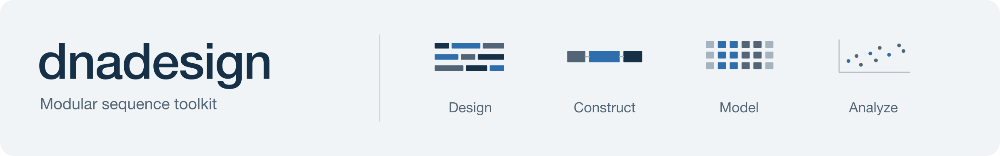

`dnadesign` brings together tools for sequence design, modeling, and analysis in
one Python monorepo. Use each tool independently or combine them through public
APIs, command-line interfaces, and shared data formats.

## Available tools

Each tool's documentation covers its setup, examples, inputs, and outputs.

### Design, modeling, and analysis

| Tool | Description |
| --- | --- |
| [**seqledger**](src/dnadesign/seqledger/) | Store, check, and sync tables of sequence records. |
| [**infer**](src/dnadesign/infer/) | Run sequence models and add their predictions to datasets. |
| [**construct**](src/dnadesign/construct/) | Build DNA constructs from reusable templates. |
| [**junction**](src/dnadesign/junction/) | Turn exact DNA targets into checked three-way-junction oligo plans. |
| [**opal**](src/dnadesign/opal/) | Use measured results to choose which DNA designs to test next. |
| [**cluster**](src/dnadesign/cluster/) | Group similar rows and visualize the groups. |
| [**latentdna**](src/dnadesign/latentdna/) | Compare sequence features and save tables and plots for review. |
| [**cruncher**](src/dnadesign/cruncher/) | Design DNA sequences and assembly plans within stated limits. |
| [**permuter**](src/dnadesign/permuter/) | Create sequence variants and evaluate them with selected tools. |
| [**aligner**](src/dnadesign/aligner/) | Compare pairs or sets of DNA and protein sequences. |
| [**thread**](src/dnadesign/thread/) | Prepare protein-design jobs and check the predicted structures. |

### Draw and inspect results

| Tool | Description |
| --- | --- |
| [**folding**](src/dnadesign/folding/) | Predict and draw how RNA sequences fold. |
| [**baserender**](src/dnadesign/baserender/) | Draw annotated sequence maps from saved jobs. |

### Run and monitor jobs

| Tool | Description |
| --- | --- |
| [**ops**](src/dnadesign/ops/) | Find, run, and inspect jobs across dnadesign. |
| [**notify**](src/dnadesign/notify/) | Send notifications for local and scheduled jobs. |

### Data shared between tools

| Tool | Description |
| --- | --- |
| [**contracts**](src/dnadesign/contracts/) | Define versioned file formats shared between tools. |

## Contributing and reference

- [Installation](docs/setup/installation.md): runtime dependencies and installation profiles.
- [Docs index](docs/README.md): workflow and tool documentation.
- [Architecture](ARCHITECTURE.md), [Design](DESIGN.md) and [Reliability](RELIABILITY.md): boundaries and operating principles.
- [Developer docs](docs/dev/README.md): contribute changes and run validation checks.
- [Security](SECURITY.md), [Plans](PLANS.md) and [Quality score](QUALITY_SCORE.md): security policy and maintenance.
