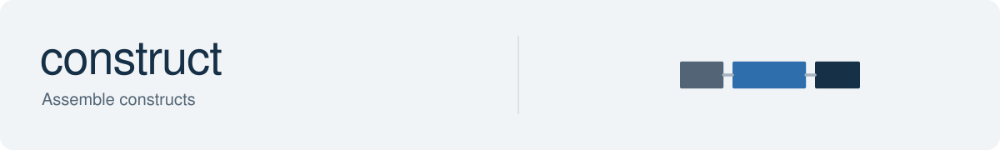

Construct places DNA parts into named positions in a template sequence and
produces the assembled sequences, part coordinates and source lineage. Use it
to prepare complete constructs or fixed-length sequence windows for downstream
analysis. For preselected linear ssDNA segments, `construct compose` writes a
local sequence and visualization bundle.

## Documentation

- [Construct docs](docs/README.md): guides and references organized by task.
- [Getting started](docs/getting-started.md): install Construct, run a small demo and inspect the resulting sequences.
- [Workspaces](workspaces/README.md): choose a demo or configure your own inputs.
- [Template contexts](docs/reference/template-contexts.md): pass assembled sequences and part coordinates to other tools.
- [Linear ssDNA composition](docs/reference/linear-ssdna-composition.md): join already chosen segments into a local bundle.
- [Repository docs](../../../docs/README.md): installation options and workflows across DNADesign tools.
