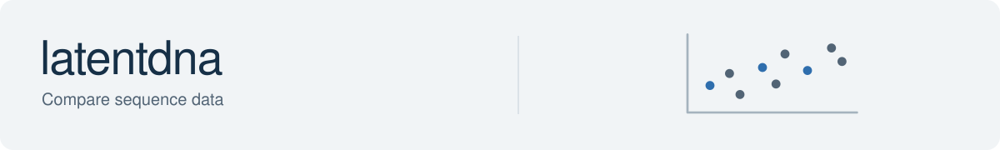

LatentDNA compares learned sequence representations using dimensionality reduction, neighborhoods and reference-based distances. It works with precomputed vectors and saves the resulting tables, plots and analysis provenance in a workspace.

## Documentation

Start with the [LatentDNA guide](docs/README.md) or [run a small local analysis](docs/getting-started/README.md). The example needs no model download or GPU.

- [Analysis workflows](docs/workflows/README.md): choose a comparison and understand its outputs.
- [Workspaces](workspaces/README.md): organize inputs, configuration and generated artifacts.
- [CLI reference](docs/reference/cli-contracts.md) and [workspace schema](docs/reference/workspace-schema.md): configure and run an analysis.
- [Operations](docs/operations/README.md): inspect outputs, check freshness and rebuild when inputs change.

[Infer](../infer/) can generate vectors, and [SeqLedger](../seqledger/) can store their sequence records and sidecars. LatentDNA reads those inputs without running inference or changing the source datasets. [External study workspaces](../../../docs/integrations/study-workspaces.md) keep study-specific labels and interpretation with the analysis that uses them.
