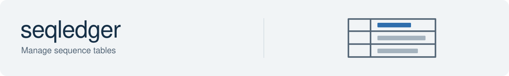

SeqLedger stores DNA, RNA and protein sequences with their annotations and processing history. Its CLI and Python API let you import records, attach results by sequence ID, inspect the combined data and transfer datasets between machines.

## Documentation

Start with the [SeqLedger guide](docs/README.md), or [create your first dataset](docs/getting-started/cli-quickstart.md).

- [Python API](docs/reference/python-api.md): read and annotate datasets from scripts.
- [Sync over SSH](docs/operations/sync/README.md): configure a remote and review transfers.
- [Reference](docs/reference/README.md): record identity, annotations, storage and maintenance.
- [Operations](docs/operations/README.md): combine datasets and connect other tools.

## Dataset location

The default root is `./seqledger_datasets`, relative to your working directory. Create it before starting a collection, or select an existing root with `--root /path/to/datasets` or `DNADESIGN_SEQLEDGER_ROOT`. Keep datasets outside the installed package; installing or upgrading SeqLedger does not move them.

A dataset combines a base sequence table with separate annotation files, called overlays. Reads and exports include those annotations without requiring a rewrite of the base table. See the [storage layout](docs/reference/dataset-layout-and-code-map.md) for file details and the [DNADesign guide](../../../docs/README.md) for other tools.
