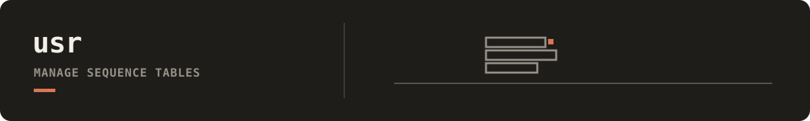

Universal Sequence Record (USR) stores sequence datasets with explicit overlay and mutation-event contracts. It is the integration boundary for tools that write sequence outputs and derived annotations, maintain `records.parquet`, append namespaced overlays under `_derived/`, and emit `.events.log` mutation events for downstream operators.

## Documentation

- [USR docs index](docs/README.md): map for all USR workflows and references.
- [CLI quickstart](docs/getting-started/cli-quickstart.md): first runnable path (`init` -> `import` -> `attach` -> `materialize` -> `export`).
- [Operations runbooks](docs/operations/README.md): remote sync, iterative batch loops, and transfer safety checks.
- [Reference index](docs/reference/README.md): stable contracts for schema, overlays/registry, event payloads, and API usage.
- [Architecture introspection](docs/architecture-introspection.md): package lifecycle, component boundaries, and interaction map.
- [Repository docs index](../../../docs/README.md): cross-tool workflows that connect USR with DenseGen, Infer, and Notify.

## Dataset location

USR uses `./usr_datasets` relative to the working directory by default. Create
that directory before starting a new collection, or select an existing root with
`--root /path/to/datasets` or `DNADESIGN_USR_ROOT`. Installation and upgrades do
not move datasets.

If you previously used `src/dnadesign/usr/datasets`, pass that root explicitly
while migrating. Copy the **whole** root, including `registry.yaml`, overlays,
views, event logs, and snapshots, to a directory outside the checkout. Validate
the copy with `usr --root /new/root validate <dataset> --strict` and verify all
files before changing configured paths or removing the original. Update remote
profiles and workflow configs to the new root together.

## Remote configuration

Remote profiles are local operator configuration, not repository data. Copy
[`remotes.example.yaml`](remotes.example.yaml) to a private, untracked path,
replace the example values, and select it explicitly:

```bash
mkdir -p "$HOME/.config/dnadesign"
install -m 600 src/dnadesign/usr/remotes.example.yaml "$HOME/.config/dnadesign/usr-remotes.yaml"
# Edit usr-remotes.yaml and replace every example value before use.
export USR_REMOTES_PATH="$HOME/.config/dnadesign/usr-remotes.yaml"
uv run usr remotes list
```

The loader does not fall back to the tracked example or to a repository-local
active profile.
